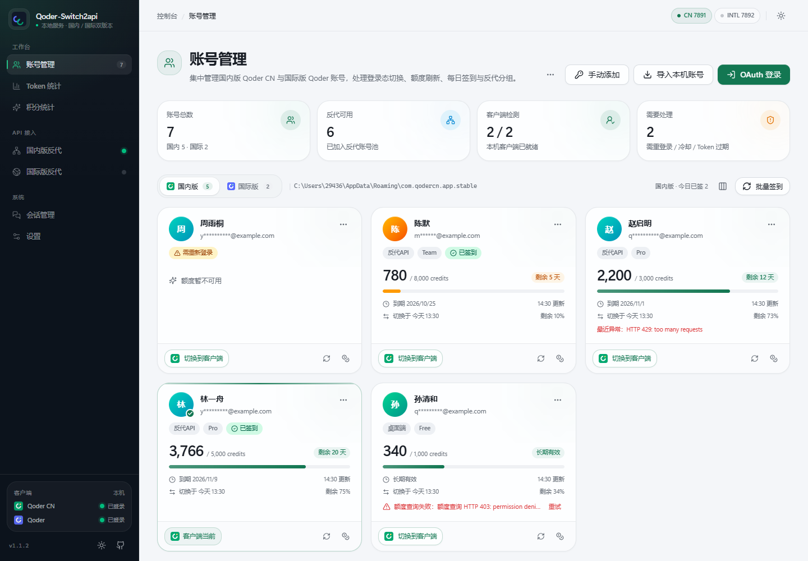
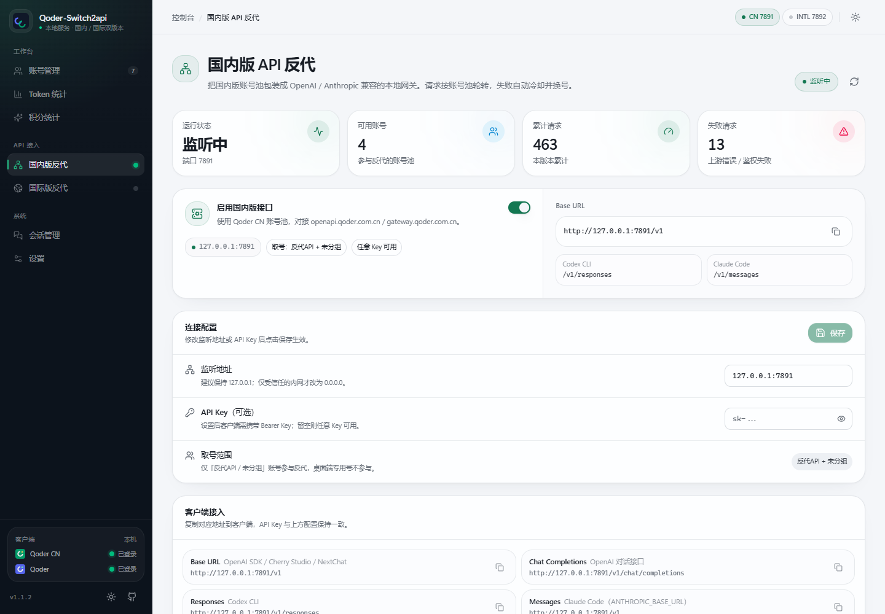
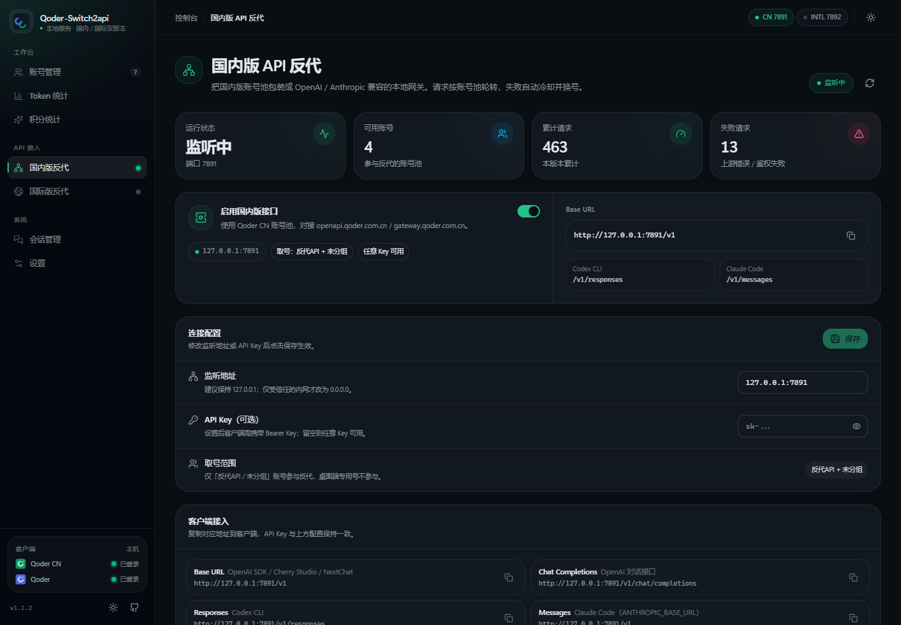

# Qoder-Switch2api

Qoder（**国内版 Qoder CN / 国际版 Qoder**）多账号切换 + OpenAI / Anthropic 兼容反代。

界面与架构参考 [WorkBuddy-Switch2api](https://github.com/cv-superding/WorkBuddy-Switch2api)，Qoder 协议参考
[qoder2api](https://github.com/jyao0708/qoder2api)（Go）与 [Qoder-Switch](https://github.com/70548887/Qoder-Switch)（Rust/Tauri），
并针对**国内 / 国际双版本**做了账号池、认证文件、进程与域名的完全隔离。

```
┌──────────────────────────────────────────────────────────────┐
│  WebUI (React + TS + Tailwind，:8787)                         │
│  账号管理 / 积分统计 / Token 统计 / API 反代 / 会话管理 / 设置   │
├──────────────────────────────────────────────────────────────┤
│  Node 服务端 (Express，:8787)                                  │
│  ├─ /api/*            WebUI 后端                              │
│  ├─ 账号池            加密存储 · 轮转 · 冷却 · 续期              │
│  ├─ 切换器            读写 Qoder 客户端登录态 + 重启进程          │
│  └─ 反代网关          国内版 :7891 · 国际版 :7892               │
│      POST /v1/chat/completions   OpenAI Chat（流式/非流式）     │
│      POST /v1/responses          OpenAI Responses（Codex CLI） │
│      POST /v1/messages           Anthropic Messages（Claude Code）│
│      GET  /v1/models · GET /healthz · GET /usage-stats        │
└──────────────────────────────────────────────────────────────┘
```

## 界面预览

> 截图使用演示数据，不代表真实账号信息。





<details>
<summary>暗色模式</summary>



</details>

## 功能

| 模块 | 说明 |
|---|---|
| 双版本账号池 | 国内版（Qoder CN，`*.qoder.com.cn`）与国际版（Qoder，`*.qoder.sh` / `qoder.com`）账号、认证文件、进程、域名完全独立，账号页用标签页分开 |
| 账号添加 | ① OAuth 设备流登录（PKCE S256，自动打开浏览器 + 轮询授权）② 导入本机客户端登录态 ③ 手动添加 PAT / IDE token ④ 备份文件导入 |
| 备份与迁移 | 导出账号 JSON，可选包含完整登录态；导入后可直接用于反代，也可只迁移账号信息 |
| 账号切换 | 把目标账号写入 Qoder 客户端登录态（新版 `auth.v1.dat` / 旧版 `state.vscdb`）并重启客户端；切换前自动备份，四步进度反馈 |
| OpenAI / Anthropic 反代 | 账号池轮转（额度优先 + round-robin）、失败冷却 120s、401/403 自动续期换号、按档位独立监听 |
| 积分与签到 | Credits 额度 / 套餐 / 到期监控；campaigns 每日签到（批量 + 自动定时，幂等） |
| Token 统计 | 请求数、输入/输出 Token 趋势图（Recharts），按账号 / 模型 / API 分布，落盘可查 |
| 会话管理 | 发现本机工作区与聊天历史（`lingma.chat.localHistory.*`），导出 JSON / Markdown |
| 桌面托盘 | 关闭窗口可收进系统托盘，WebUI / 反代 / 自动签到继续运行；托盘菜单可显示窗口或退出 |
| 安全 | 账号库 AES-256-GCM 加密存储（机器密钥派生）；客户端 OSCrypt 密钥仅在本机经 DPAPI 解出，不出内存 |

## 快速开始

提供两种运行方式，**功能完全一致**（同一套 React 前端 + 同一套业务逻辑）：

### 方式一：Node 服务模式（无需 Rust，开箱即用）

```bash
# 环境要求：Node.js >= 22.5（使用内置 node:sqlite 读取客户端数据库）
npm install
npm run dev        # 开发模式（前端 5173 + 后端 8787）
npm run build      # 生产构建
npm start          # 单端口托管前端 + API + 反代 → http://127.0.0.1:8787
```

也可以直接从 [Releases](https://github.com/cv-superding/Qoder-Switch2api/releases) 下载 Windows
可执行文件：`qoder-switch2api.exe`（桌面窗口）或 `qoder-server.exe`（仅本地服务）。

### 方式二：Tauri 桌面模式（Rust 后端，同参考项目 WorkBuddy-Switch2api 形态）

```bash
# 环境要求：Rust 工具链（rustup 安装）+ Node.js >= 22.5
#   Windows 需要 MSVC 链接器（Visual Studio Build Tools 的 C++ 工作负载），
#   或使用 windows-gnu 工具链（rustup toolchain install stable-x86_64-pc-windows-gnu）
npm install
npm run desktop:dev    # 开发模式（Vite 5173 + Tauri 窗口，热重载）
npm run desktop:build  # 产出安装包（src-tauri/target/release/bundle/nsis|msi）
```

Rust 版内置同一 Web 服务（127.0.0.1:8787，/api/* + 嵌入式前端），反代与 Node 版行为一致。

### 使用步骤

1. **账号管理** → 「OAuth 登录」或「导入本机账号」（自动读取本机已安装的 Qoder 客户端登录态）
2. **API 反代** → 打开「启用国内版接口」，监听地址默认 `127.0.0.1:7891`
3. 客户端接入：`http://127.0.0.1:7891/v1`（OpenAI 兼容）；Codex CLI 用 `/v1/responses`；Claude Code CLI 设 `ANTHROPIC_BASE_URL=http://127.0.0.1:7891`

反代端口可在页面修改；API Key 可留空（任意 Key 可用）或设置后要求 `Authorization: Bearer <key>`。
监听端口被占用时，反代页会直接显示失败原因，修改端口后保存即可重试。

## 目录结构

```
├── src-tauri/                # Tauri Rust 壳层（桌面模式）
│   ├── src/
│   │   ├── main.rs / lib.rs  # 入口：Web 服务 + 反代调度 + 自动签到
│   │   ├── editions.rs       # 国内/国际档位定义（端点、目录、进程名）
│   │   ├── paths.rs          # 数据目录与客户端路径解析
│   │   ├── crypto.rs         # AES-GCM（账号库）+ OSCrypt/DPAPI（客户端登录态）
│   │   ├── store.rs          # JSON 加密持久化（原子写）
│   │   ├── switcher.rs       # 客户端账号切换（备份→杀进程→写凭证→重启）
│   │   ├── sessions.rs       # 工作区/聊天历史发现与导出
│   │   ├── qoder/            # cosy.rs / chat.rs / oauth.rs / account.rs / info.rs
│   │   ├── proxy/            # gateway.rs（OpenAI/Anthropic 网关）+ usage.rs
│   │   ├── api.rs            # WebUI REST API
│   │   └── state.rs          # 共享状态
│   ├── icons/                # 应用图标（npm run icon 重新生成）
│   └── tauri.conf.json
├── server/                  # Node 后端（ESM，服务模式）
│   ├── index.js             # 入口：Web 服务 + 反代调度 + 自动签到
│   ├── editions.js          # 国内/国际档位定义（端点、目录、进程名）
│   ├── paths.js             # 数据目录与客户端路径解析
│   ├── crypto.js            # AES-GCM（账号库）+ OSCrypt/DPAPI（客户端登录态）
│   ├── store.js             # JSON 加密持久化（原子写）
│   ├── switcher.js          # 客户端账号切换（备份→杀进程→写凭证→重启）
│   ├── sessions.js          # 工作区/聊天历史发现与导出
│   ├── qoder/
│   │   ├── cosy.js          # Cosy 签名协议（AES-128-CBC + RSA + MD5 + 自定义 base64）
│   │   ├── chat.js          # 双后端：legacy SSE 流式 + Cloud Agents PAT
│   │   ├── oauth.js         # OAuth 设备流（登录/轮询/续期）
│   │   ├── account.js       # 账号池（轮转/冷却/分组/续期）
│   │   └── info.js          # 额度/套餐/签到/模型列表
│   ├── proxy/
│   │   ├── gateway.js       # OpenAI/Anthropic 兼容网关（每档位一实例）
│   │   └── usage.js         # 用量统计
│   └── routes/api.js        # WebUI REST API
├── src/                     # React 前端
│   ├── App.tsx              # 布局 + 路由（左侧导航，双版本入口）
│   ├── pages/               # 账号/反代/Token/积分/会话/设置
│   ├── components/          # 账号卡片、OAuth/切换/添加/备份对话框
│   └── lib/                 # API 客户端、类型、主题
├── docs/API-PROXY.md        # Qoder 协议与反代实现细节
└── scripts/smoke-ssr.mjs    # SSR 冒烟测试（npm run smoke）
```

## 数据与凭证存放

| 数据 | 位置 |
|---|---|
| 账号库（加密） | `~/.qoder-switch/accounts.json` |
| 反代配置 / 设置 | `~/.qoder-switch/settings.json` |
| 用量统计 / 签到日志 | `~/.qoder-switch/usage.json` / `checkin.jsonl` |
| 会话导出 | `~/.qoder-switch/exports/` |
| Qoder CN 客户端登录态 | `%APPDATA%/com.qodercn.app.stable/auth.v1.dat`（或 `QoderCN` / `Qoder CN`） |
| Qoder 国际版客户端登录态 | `%APPDATA%/com.qoder.app.stable/auth.v1.dat`（兼容旧版 `%APPDATA%/Qoder`） |

> 账号凭证等同密码，请勿分享备份文件。本工具不上传任何数据到第三方服务器。

## 端点说明（已实测验证）

| 用途 | 国内版（Qoder CN） | 国际版（Qoder） |
|---|---|---|
| OAuth 登录页 | `qoder.com.cn/device/selectAccounts` | `qoder.com/device/selectAccounts` |
| OpenAPI（账号/额度/签到） | `openapi.qoder.com.cn` | `openapi.qoder.sh` |
| 流式对话（Cosy SSE） | `gateway.qoder.com.cn/algo/api/v2/service/pro/sse/agent_chat_generation` | `api3.qoder.sh/algo/api/v2/service/pro/sse/agent_chat_generation` |
| Cloud Agents（PAT） | `api.qoder.com.cn/api/v1/cloud` | `api.qoder.com/api/v1/cloud` |
| Token 续期 | `POST /api/v1/deviceToken/refresh` | 同左 |

国内版端点来自阿里云官方防火墙白名单与多个开源项目交叉验证；国际版端点来自 qoder2api 与 Qoder 官方
Cloud Agents 文档。个别未公开字段（如 CN 版 OAuth client_id）标注为推断，可在「设置 → API 端点覆盖」中修改。

## 已知限制

- **客户端切换写路径已做 round-trip 验证，但未做跨账号实测**（会终止用户正在运行的 Qoder 进程，需自行确认后使用）；切换前会自动备份 `auth.v1.dat` / `state.vscdb` 到同目录 `.bak-<时间>`。
- macOS / Linux 的客户端登录态加密密钥在系统钥匙串中，暂不支持自动读写（可 OAuth 登录 / 手动添加账号，反代功能不受影响）。
- `request_set_id` 字段实测会导致国内版网关挂起，已从请求体中移除（见 docs/API-PROXY.md）。
- 国际版 legacy 流式端点（api3.qoder.sh）按 qoder2api 移植，未持国际版账号实测。

## 更新日志

### v1.1.16

- 修复 npm 11 生成的锁文件与 CI 的 npm 10 不兼容，确保应用内更新版本可以正常发布构建
- 功能与 v1.1.15 一致：内置下载、实时进度条、重启安装、系统代理与 SHA-256 校验

### v1.1.15

- 下载更新改为应用内下载，顶部提醒和设置页都会显示实时进度条、已下载大小与百分比
- 下载完成后直接「重启并安装」：退出当前程序、等待进程结束、替换 exe 并自动重启
- 更新检查与下载支持系统代理 / `HTTPS_PROXY` 环境变量，解决 GitHub 下载域名无法直连的问题
- 下载包使用 GitHub Release 的 SHA-256 校验；直连失败时可用镜像兜底，校验不通过不会安装
- 独立服务模式（`qoder-server.exe` / Node）不支持自替换，会提示已下载文件的路径，手动运行即可

### v1.1.14

- 更新检查更及时：前端每 15 分钟检查一次，切回窗口时也会补查（5 分钟内已查过则跳过）
- 后端更新缓存从 30 分钟缩短到 5 分钟，新版本发布后不再长时间无提示
- GitHub API 限流或不可用时，自动改用 Releases 页面重定向兜底，不依赖 API 配额
- 修复应用启动时恰好早于新版本发布、之后长时间不再提示更新的问题

### v1.1.13

- 修复一个请求错误导致账号被冷却、后续全部报 503「没有可用账号」的连锁问题
- 上游 400 / 404 / 413 / 415 / 422 等请求类错误现在立即返回，不再换号重试，也不会冷却健康账号
- 400 错误信息补充模型名和排查提示（上下文长度、工具/参数兼容性、更换模型）
- 已用模拟 400 上游验证：连续请求都会正常到达上游，账号保持 active，不再被误冷却

### v1.1.12

- 修复反代失败请求在 Token 统计中显示「未知账号」：失败时也会记录最后尝试的账号
- 账号显示名支持多级回退（名称 → 邮箱 → 手机 → 备注 → UID → ID），不再因名称为空丢失归因
- 没有可用账号时单独标记为「无可用账号」，与真实账号失败区分
- Node 与 Rust 后端同步修复

### v1.1.11

- 新增版本更新检查：启动时自动检查 GitHub Releases，发现新版本在顶部提醒并弹出通知
- 设置页「关于」支持手动检查更新，显示当前版本 / 最新版本，并可直接下载新版本
- 更新提醒支持「忽略此版本」；程序运行期间每 6 小时自动检查一次，后端缓存 30 分钟避免 GitHub 限流
- 更新提醒旁新增 GitHub 入口与「求个 Star」按钮

### v1.1.10

- 修复「获取上游模型」失败：模型列表接口需要 Cosy 签名，裸 Bearer 请求会 403 `Signature invalid`
- 按当前上游规则重写模型列表请求：签名路径剥离 `/algo`、`cosy-version=1.0.0`、附带 bodyhash / sigpath 等新头
- 国际版模型列表按 api1 → api2 → api3 自动兜底，解析新版 `chat` 场景并过滤禁用模型
- 已用真实国内版 / 国际版账号实测，分别返回 14 / 15 个模型

### v1.1.9

- 修复签到判据：领取后上游会把 `actionType` 降级为 `VIEW_DETAILS`，现在以 `claimStatus` 为主，避免把已签到误报成未签到
- 支持一次领取全部可领的积分类活动，不再只领第一个；自动签到遇到临时失败会在下一轮重试
- 账号卡片显示真实签到状态：已签到 / 可签到 / 无签到活动 / 签到未知，不再一律显示「未签到」
- 新增 `/api/checkin/status`，进入账号页时实时查询上游签到状态
- 会话管理兼容新版 Qoder 客户端：改为读取 `main.sqlite` 的 `chat_sessions`，旧版 `state.vscdb` 仍保留兜底
- 已用真实账号验证额度合并、签到状态；并用本地模拟上游端到端验证自动签到、反代三种协议与用量统计

### v1.1.8

- 修复额度统计只读取套餐额度、漏掉 `addOnQuota` 的问题：总额 / 剩余 / 进度条现在合并「基础额度 + 赠送/签到额度」
- 账号卡片与积分统计页新增额度明细，可分别查看基础额度与赠送额度
- 修正额度接口仅返回 `percentage` 时的兜底换算（上游该字段是已用比例）
- 参考 qoder-trae-workbuddy-switch、qoder2api-hub、cpa-multi-plugins 等项目的额度口径

### v1.1.7

- 额度进度条改为按剩余额度比例着色（绿色充足 / 橙色偏低 / 红色耗尽），到期紧急程度只由徽标提示
- 桌面版新增系统托盘：关闭窗口默认收进托盘，WebUI、反代与自动签到继续运行
- 设置页新增「关闭窗口时最小化到托盘」开关，托盘菜单支持显示主窗口与退出
- 修复 300/300 额度但临近到期时整条进度条变橙色、容易被误读为额度不足的问题

### v1.1.6

- 账号页明确显示本机检测到的客户端版本（Qoder CN 国内版 / Qoder 国际版）
- 版本标签补充产品名，减少国内版 / 国际版混淆
- API 反代页当前版本没有可用账号时，提示并可直接跳转到已配置的另一版本
- 无可用账号时禁用「获取上游模型」，避免弹出无意义的失败提示

### v1.1.5

- 支持自定义安装目录：从运行中的 Qoder 进程识别真实 `Qoder.exe`，修复切换时无法结束/重启客户端
- 结束进程只匹配当前版本的可执行文件路径，避免误杀另一版本 Qoder
- OAuth 登录复用已检测客户端的 machine_id / machine_token
- 导入本机账号后立即标记为客户端当前账号

### v1.1.4

- 支持新版 Qoder 客户端数据目录 `%APPDATA%/com.qoder.app.stable`，修复误报“未安装”、导入本机账号失败
- 账号页首次进入自动选中本机已安装的版本；选错版本时「导入本机账号」会自动从另一个已安装客户端导入
- 增加“当前版本未检测到客户端 / 另一版本已安装”的提示与版本切换按钮

### v1.1.3

- 桌面窗口默认尺寸从 1280×860 调整为 1100×740，最小尺寸 900×600
- README 增加真实界面预览截图（演示数据）

### v1.1.2

- 修复手动 Token 账号因 Cosy 头缺少 machineId 触发 `randomUUID is not defined`，导致请求全部失败
- 修复反代未使用设置页的 API 端点覆盖、上游 401 被统一吞成 503、SSE 错误帧被当成成功空响应
- **结束 Qoder 进程改为按可执行文件绝对路径精确匹配**，不再按进程名全局结束，避免误关其它 Qoder 窗口
- 无客户端登录 Token 的账号（PAT / 备份占位）拒绝切换，避免写入空登录态；切换不再沿用上一个账号的身份与 refresh token
- Rust 侧补齐上游请求超时、`/v1/responses` 与 `/v1/messages` 流式输出、用量排序与 Token 统计、会话导出路径校验
- 修复会话目录导出路径穿越、设置小时越界、JSON 文件跨进程写入冲突、Token 续期未更新 refresh 到期时间等问题

### v1.1.1

- 修复 GitHub Actions 中 `npm ci` 因可选依赖锁文件不一致导致发布失败的问题
- 其余功能与 v1.1.0 相同

### v1.1.0

- 重做界面：深色侧栏 + 浅色工作区、完整暗色模式、移动端抽屉导航、统一卡片与图表样式
- 修复备份导入导出不包含登录态、OAuth 无法打开系统浏览器、Token 过期状态不显示、套餐信息不显示等问题
- 修复切换账号对话框在父组件刷新时可能重复触发切换任务的问题
- 修复反代端口占用时状态误报、设置保存时反代被无谓重启、签到 `none` 状态被误记为已签到等问题
- 统一 Node / Rust 账号库字段命名为 camelCase，并兼容旧数据迁移
- 修复自动签到使用 UTC 日期、错过整点后不补签的问题

## 致谢

- [WorkBuddy-Switch2api](https://github.com/cv-superding/WorkBuddy-Switch2api) — 界面与架构参考
- [qoder2api](https://github.com/jyao0708/qoder2api) — Qoder Cosy/Cloud 协议参考
- [Qoder-Switch](https://github.com/70548887/Qoder-Switch) — 客户端切换与会话管理参考
- [cpa-multi-plugins](https://github.com/lg996/cpa-multi-plugins) / [dsh-qoder-connect](https://github.com/YSwo-fei/dsh-qoder-connect) — Qoder CN 端点交叉验证

## 免责声明

本项目仅供学习与研究使用。多账号切换与反代可能违反 Qoder 服务条款，请自行评估风险；
作者不对账号封禁、数据丢失等后果负责。
